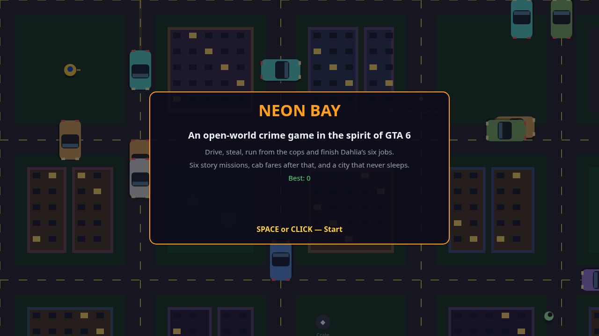
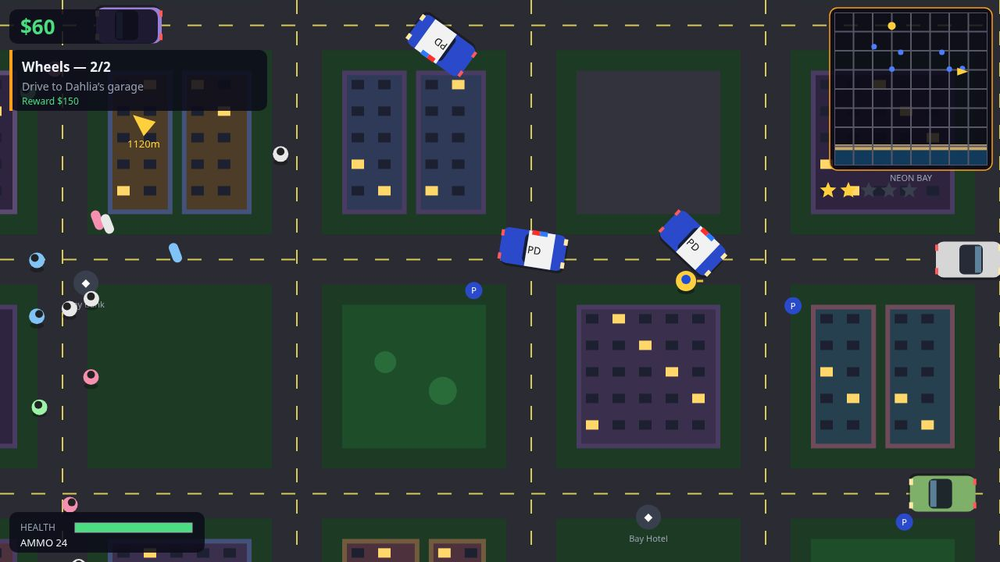
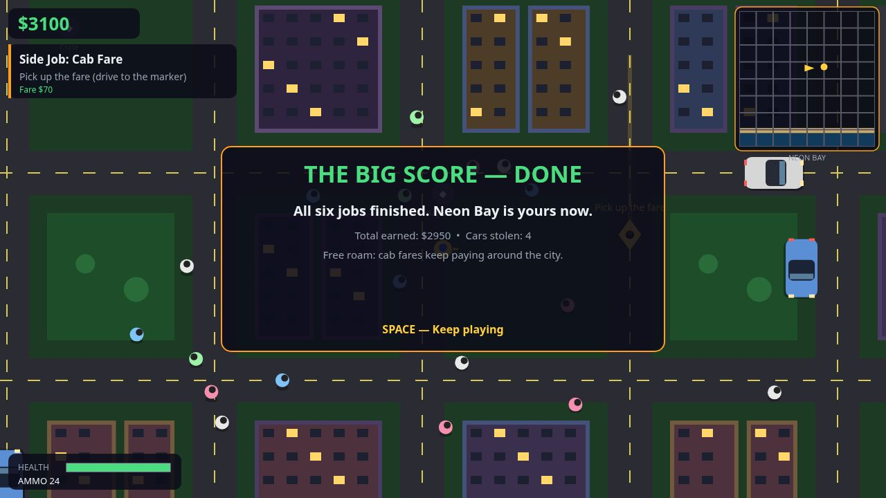

# Neon Bay

[](https://make.fun/bounty/gta6-01)
[](LICENSE)

**Neon Bay** is a top-down 2D open-world crime game in the spirit of GTA 6,
made for the [make.fun "Make GTA 6" bounty](https://make.fun/bounty/gta6-01).
Steal cars, outrun the police, and take on Dahlia's six story jobs in a
night city that keeps moving — then keep the money coming with cab fares in
free roam. The city, the characters and the story are all invented for this
game; nothing here uses Rockstar assets, names or maps.





## Play it

No build step, no dependencies, no network. Open `game/index.html` in a
desktop browser, or serve the folder and visit it:

```sh
node serve.ts          # serves the game at http://localhost:8080
# or
python3 -m http.server --directory game 8000
```

The game runs fully offline once the files are on disk. Your progress
autosaves to `localStorage` (key `neon-bay.save.v1`); the best score is kept
under `neon-bay.best.v1`.

## Controls

| Keys | Action |
| ---- | ------ |
| WASD / arrows | Move on foot, drive |
| E | Enter / exit a car, jack a nearby car, confirm a prompt |
| F | Punch (on foot) |
| Mouse aim + click | Shoot the pistol (on foot or from a car) |
| Space / Enter | Start, confirm, dismiss a panel |
| Shift | Run (on foot) / handbrake (driving) |
| P / Esc | Pause |
| M | Mute the sound |

## What is in the game

- **A city that never sleeps** — a 2400×2400 grid of roads, blocks,
  buildings with lit windows, parks and a beach, filled with traffic and
  pedestrians, all laid out by a seeded generator (the same seed always
  builds the same city).
- **Six story missions** from Dahlia, each with its own payout:
  1. *Wheels* ($150) — steal a car and bring it to the garage.
  2. *Cab Fare* ($200) — pick up a client at the docks and drop them at
     the Bay Hotel.
  3. *Hot Delivery* ($300) — a parcel to the North Pier in 90 seconds.
  4. *Heat* ($400) — raise two wanted stars, then shake the tail.
  5. *Three Crates* ($500) — collect three crates stashed around town.
  6. *The Big Score* ($1,500) — hold the bank vault, then lose a
     three-star tail at the safehouse.
- **Free roam after the story** — repeatable cab fares ($60–$120) keep
  paying around the city.
- **Wanted system** — 0 to 5 stars. Crimes raise your heat; police cars
  chase, ram and try to box you in, and foot cops close in when you are on
  foot. Get caught and you are busted: a fine, a respawn at the police
  station, and a clean slate. Lay low and the heat fades on its own.
- **Driving** — acceleration, braking, handbrake turns, sliding collision
  with buildings, traffic that brakes and swerves, and cars that take
  damage and can be wrecked.
- **Carjacking** — walk up to any parked or traffic car and take it. The
  driver bails and the car is yours, heat included.
- **Combat** — fists and a pistol with ammo. The gun shop sells bullets;
  the spray shop clears your wanted level and repairs your car.
- **HUD** — money, health, ammo, mission tracker with a GPS arrow and
  distance, a live minimap with the mission marker, police dots and your
  position, and the wanted stars.
- **Sound** — a fully synthesized WebAudio soundtrack: engine hum, police
  sirens, gunshots, punches, pickups and mission jingles. No audio files.
- **Save and best score** — the game autosaves every 15 seconds and on
  mission completion; the title screen shows your best total.

## How it is built

Plain JavaScript ES modules and Canvas 2D, in `game/src/`. No framework,
no build tool, no assets to download:

- `config.js` — tuning, palette, missions, places, police and wanted rules.
- `city.js` — the seeded city generator (roads, blocks, buildings, beach).
- `world.js` — the simulation: player, traffic AI, pedestrians, police,
  wanted, combat, missions, side jobs, shops, busted/wasted, save/load.
- `render.js` — camera, city, cars, people, HUD, minimap and screens.
- `input.js` — keyboard and mouse.
- `audio.js` — synthesized WebAudio effects.
- `shots.js` — the staged title / play / story-complete scenes used for
  the screenshots (`?shot=start|play|end`).
- `main.js` — boot, the fixed-step loop, screens and autosave.

`main.ts` (Node 22, standard library only) copies `game/` and
`screenshots/` into the output directory and writes `dossier.json`.

## Verify it yourself

```sh
# syntax-check every module
for f in game/src/*.js; do node --check "$f"; done

# run the headless end-to-end simulation (missions 1-6, busted, save/load)
node /tmp/test-full.mjs   # test driver, kept outside the repo
```

The simulation plays the full story arc — all six missions, the busted
flow, a save/load round trip and a three-minute soak — and prints
`ALL WORLD CHECKS PASSED` when everything holds.

## License

MIT — see [LICENSE](LICENSE).

---

Built for the make.fun bounty — play more games and earn on make.fun:
https://make.fun/r/nnqh4m6a (referral code: `nnqh4m6a`)
